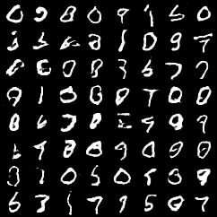

# Gentext API: Bigram Generation + Word Embeddings

FastAPI service (built with uv and Docker) that extends the Module 3 class activity with
**word embeddings** from spaCy (`en_core_web_lg`, 300-dimensional vectors) from Module 2.

## Project structure

```
gentext-app/
├── app/
│   ├── __init__.py
│   ├── bigram_model.py      # Module 3: bigram text generator
│   ├── embedding_model.py   # NEW: spaCy word embeddings + similarity
│   └── main.py              # FastAPI endpoints
├── tests/test_api.py        # pytest tests for every endpoint
├── Dockerfile
├── pyproject.toml / uv.lock # the spaCy model is a pinned dependency
└── README.md
```

## Run with Docker

```bash
docker build -t gentext-app .
docker run -p 8000:80 gentext-app
```

The container listens on port 80, so map it to 8000 on your machine (`-p 8000:80`).
Then open the interactive docs at http://127.0.0.1:8000/docs

## Run locally (without Docker)

```bash
uv sync
uv run fastapi run app/main.py
uv run pytest   # run the tests
```

## Endpoints

| Method | Path | Body / params | Returns |
|---|---|---|---|
| GET | `/` | none | `{"Hello": "World"}` |
| POST | `/generate` | `{"start_word": "the", "length": 10}` | bigram-generated text |
| **POST** | **`/embedding`** | `{"word": "apple", "truncate": 10}` (`truncate` optional) | `{"word", "dimension", "embedding"}` |
| **GET** | **`/embedding/{word}`** | optional `?truncate=10` | same as above |
| POST | `/similarity` | `{"word1": "apple", "word2": "orange"}` | cosine similarity |

Unknown words (no vector in the model) return **404**.

### Examples

```bash
curl -X POST http://127.0.0.1:8000/embedding \
     -H "Content-Type: application/json" \
     -d '{"word": "apple", "truncate": 5}'
# {"word":"apple","dimension":300,"embedding":[-0.36391,0.43771,-0.20447,-0.22889,-0.14227]}

curl http://127.0.0.1:8000/embedding/king

curl -X POST http://127.0.0.1:8000/similarity \
     -H "Content-Type: application/json" \
     -d '{"word1": "apple", "word2": "car"}'
# {"word1":"apple","word2":"car","similarity":0.217...}
```
## Assignment 3: GAN for MNIST Digit Generation

### Model
`app/gan_model.py` implements the Generator and Discriminator:

- **Generator:** noise (100) → Linear → 7×7×128 → ConvTranspose2d (128→64, 14×14) + BatchNorm + ReLU → ConvTranspose2d (64→1, 28×28) + Tanh
- **Discriminator:** Conv2d (1→64, 14×14) + LeakyReLU(0.2) → Conv2d (64→128, 7×7) + BatchNorm + LeakyReLU(0.2) → Flatten → Linear → 1

### Training
```
python train_gan.py
```
Downloads MNIST to `data/`, trains for 10 epochs (Adam, lr = 0.0002, betas = (0.5, 0.999)), saves a sample grid for each epoch to `samples/`, and saves the generator weights to `app/gan_generator.pth`.

### API endpoint
Start the server:
```
uvicorn app.main:app --reload
```
`GET /generate_digits?n=16` returns a PNG grid of `n` generated digits (1 ≤ n ≤ 64).

Example: http://127.0.0.1:8000/generate_digits?n=16

### Sample output (epoch 10)

